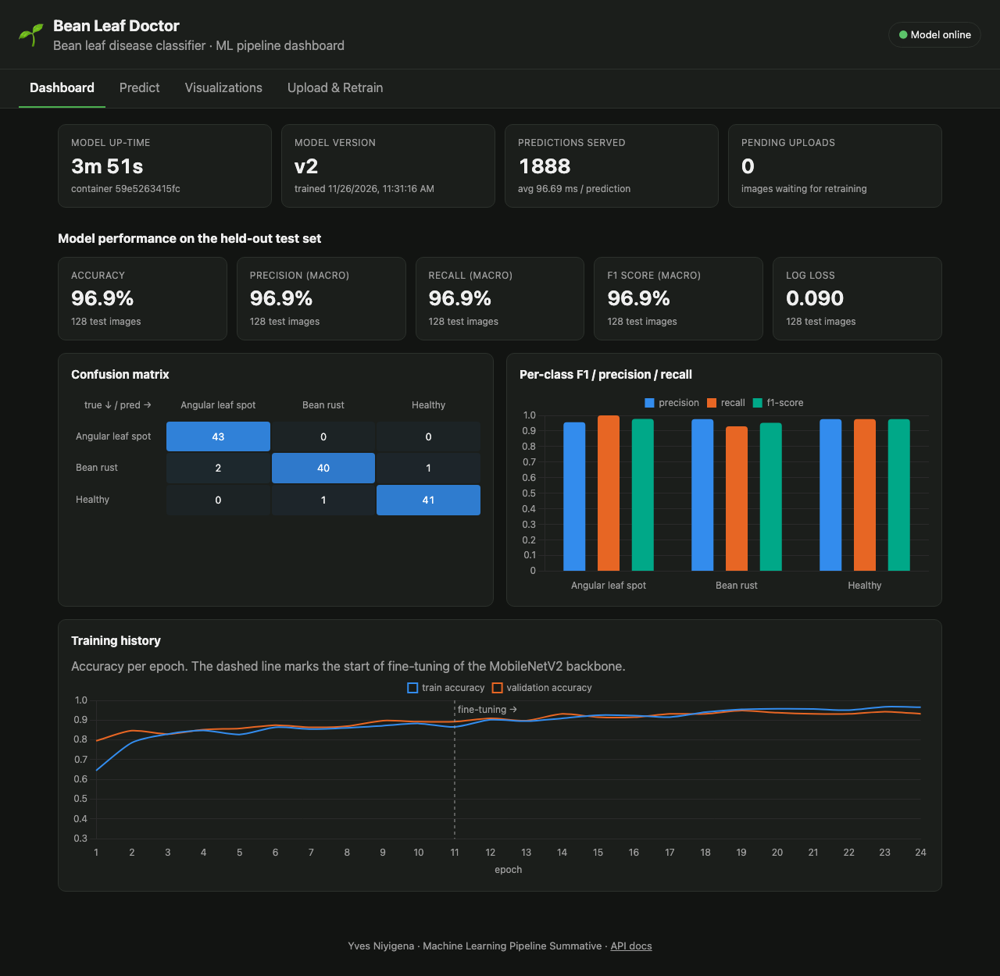
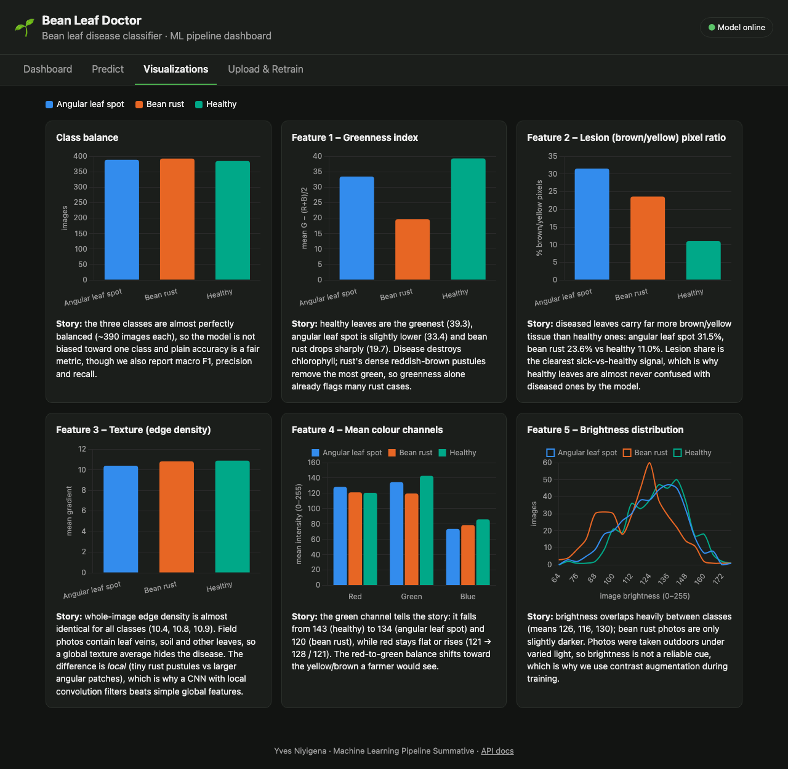
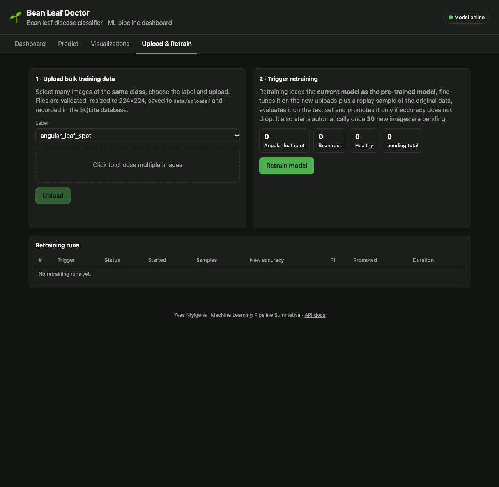
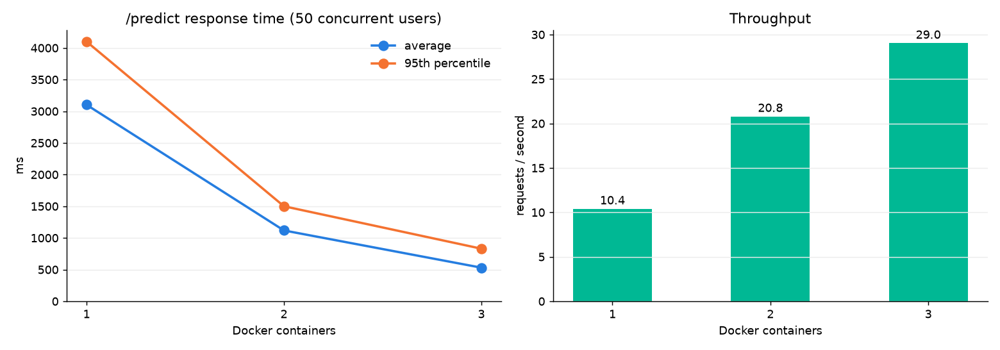

# Bean Leaf Doctor: End-to-End ML Pipeline for Bean Disease Detection

**Author:** Yves Niyigena

| | |
|---|---|
| **Video demo (YouTube)** | https://www.youtube.com/watch?v=fVMrsglxL3Y |
| **Live app (Azure)** | https://bean-leaf-doctor.orangehill-b7ca103b.southafricanorth.azurecontainerapps.io (API docs: [https://bean-leaf-doctor.orangehill-b7ca103b.southafricanorth.azurecontainerapps.io/docs](https://bean-leaf-doctor.orangehill-b7ca103b.southafricanorth.azurecontainerapps.io/docs)) |
| **GitHub** | https://github.com/Niyigena-Yves/Summative-MLOP |

## Project description

Beans are a staple crop for Rwandan and East African smallholder farmers. Two fungal diseases, **angular leaf spot** and **bean rust**, cause large yield losses, and farmers rarely have quick access to an agronomist. This project is a complete machine-learning pipeline that classifies a **photo of a bean leaf** (image data, not tabular) as:

| Class | What it looks like |
|---|---|
| `angular_leaf_spot` | angular brown lesions bounded by the leaf veins |
| `bean_rust` | many small reddish-brown pustules |
| `healthy` | no visible disease |

The pipeline covers **data acquisition → preprocessing → model creation → evaluation → prediction API → web UI → upload of new data → retraining (manual button + automatic trigger) → Docker deployment and scaling → load testing with Locust.**

**Dataset:** [iBeans](https://github.com/AI-Lab-Makerere/ibean/) by the Makerere AI Lab (Uganda), 1,295 field photos taken with smartphones. Train + validation are merged in `data/train` (1,167 images), and the official test split is kept in `data/test` (128 images). Images are stored resized to 224×224.



## Model and results

* **Model:** MobileNetV2 pre-trained on ImageNet (transfer learning) + `GlobalAveragePooling → Dropout(0.3) → Dense(128, ReLU, L2) → Dropout(0.3) → Dense(3, softmax, L2)`
* **Optimisation:** data augmentation (flip, rotation, zoom, contrast), dropout, L2 regularisation, Adam, EarlyStopping (restore best weights), ReduceLROnPlateau, two-phase training (frozen backbone, then fine-tuning the top of MobileNetV2 at a low learning rate)
* **Model file:** [`models/bean_disease_model.h5`](models/bean_disease_model.h5), with metadata and metrics in [`models/model_metadata.json`](models/model_metadata.json)

Results on the **held-out test set (128 images never seen during training)**:

| Accuracy | Precision (macro) | Recall (macro) | F1 (macro) | Log loss | ROC-AUC (OvR) |
|---|---|---|---|---|---|
| **96.9%** | 96.9% | 96.9% | 96.9% | 0.09 | 0.998 |

Only 4 of 128 test images are misclassified, and **no diseased leaf is predicted as healthy** (healthy precision = 100%). The full analysis is in the notebook [`notebook/bean_leaf_disease.ipynb`](notebook/bean_leaf_disease.ipynb).

## Features of the application

| Requirement | Where |
|---|---|
| **Model prediction** (one image) | *Predict* tab: upload a leaf photo to get the class, confidence, per-class probabilities and advice. API: `POST /predict` |
| **Visualizations** (interpretation of features) | *Visualizations* tab: class balance, greenness index, lesion ratio, texture, colour channels and brightness, each with a short interpretation |
| **Bulk data upload** | *Upload & Retrain* tab: select many images, choose the label, upload. API: `POST /upload` |
| **Trigger retraining** | *Retrain model* button. API: `POST /retrain`. Retraining also starts **automatically** once 30 new images are pending (`RETRAIN_THRESHOLD`) |
| **Model up-time / monitoring** | *Dashboard* tab: up-time, container ID, model version, predictions served, average latency, test metrics, confusion matrix and training curves. API: `GET /health` |

### Feature interpretations (what the data says)



1. **Greenness index** (G − (R+B)/2): healthy leaves are the greenest (39.3), angular leaf spot is slightly lower (33.4) and bean rust drops sharply (19.7). Disease destroys chlorophyll, and rust's dense pustules remove the most green.
2. **Lesion ratio** (share of brown/yellow pixels): 31.5% for angular leaf spot and 23.6% for bean rust, against only 11.0% for healthy leaves. This is the clearest sick-vs-healthy signal.
3. **Texture (edge density):** almost identical across classes (10.4–10.9). Field photos contain veins, soil and other leaves, so a global texture average hides the disease. The difference between the two diseases is *local* (tiny pustules vs angular patches), which is why a CNN beats hand-crafted global features.
4. **Colour channels and brightness:** the green channel falls from healthy to diseased while red stays flat, and brightness overlaps across classes (outdoor lighting varies), so lighting is not a useful cue. This motivates the contrast augmentation used in training.

**Story:** colour tells us *whether* a leaf is sick, and local texture tells us *which* disease it has.

## Retraining pipeline



1. **Upload + save to database.** Uploaded images are validated (corrupt or non-image files are rejected), converted to RGB, resized to 224×224 and saved to `data/uploads/<label>/`. Each file is recorded in the SQLite database (`uploads` table) with its label and status.
2. **Preprocessing.** New images go through the same `tf.data` pipeline (decode → resize → batch → prefetch), and in-model scaling to [-1, 1] and augmentation are applied.
3. **Retraining with the existing model as the pre-trained model.** The currently deployed model's weights are loaded and fine-tuned (Adam, lr 1e-5, early stopping) on the new uploads plus a replay sample of the original data, which prevents forgetting.
4. **Evaluation + promotion.** The candidate model is evaluated on the test set. It replaces the current model only if accuracy does not drop by more than 3 points. The old version is archived, and every run (trigger, samples, metrics, duration, promoted or not) is stored in the `training_runs` table and shown in the UI.
5. **Hot reload.** All API containers detect the new model file and reload it without a restart.

## Flood request simulation (Locust)

Same test for each setup: **50 concurrent users** for 60 s, each sending a random test image to `POST /predict` (plus some `/health` calls). Each API container is limited to 1 CPU, and an nginx load balancer spreads requests across replicas (`docker compose up --scale api=N`).

| Containers | Requests | Failures | Avg (ms) | Median (ms) | p95 (ms) | p99 (ms) | Max (ms) | Throughput (req/s) |
|---|---|---|---|---|---|---|---|---|
| 1 | 605 | 0 | 3102 | 3100 | 4100 | 4200 | 4350 | 10.40 |
| 2 | 1230 | 0 | 1118 | 1100 | 1500 | 1600 | 1748 | 20.80 |
| 3 | 1715 | 0 | 530 | 520 | 830 | 1300 | 1561 | 29.03 |



**In production (Azure Container Apps, 1 replica, 2 vCPU / 4 GB, South Africa North):** 30 concurrent users for 45 s sent 324 `/predict` requests with **0 failures**: average 2,446 ms, median 2,500 ms, p95 3,100 ms, 7.55 req/s. This includes the internet round trip from Kigali to the data centre. Raw data: `locust/results/azure_1replica_stats.csv`.

**Interpretation (local Docker tests):** with 1 container the model is saturated: requests queue and the average response time reaches about 3.1 s. Adding containers scales throughput almost linearly (10 → 21 → 29 req/s), cuts the average latency by about 6× (3.1 s → 0.53 s) and the p95 latency by about 5×, with **zero failed requests** in every setup. A single inference takes about 80–100 ms, so the rest of the latency at 1 container is queueing time. Raw CSV files are in [`locust/results/`](locust/results/).

## Project structure

```
Summative-MLOP/
├── README.md
├── notebook/
│   └── bean_leaf_disease.ipynb   # preprocessing, training, evaluation, prediction, retraining
├── src/
│   ├── data_acquisition.py       # downloads + prepares the dataset
│   ├── preprocessing.py          # image validation, resizing, tf.data pipeline, upload saving
│   ├── model.py                  # model creation, training, evaluation, retraining
│   ├── prediction.py             # load model + predict one image
│   ├── retrain.py                # retraining orchestration + triggers
│   ├── database.py               # SQLite: uploads, training runs, predictions
│   └── insights.py               # image features for the visualizations
├── api/
│   ├── main.py                   # FastAPI app
│   └── static/                   # web UI (HTML/CSS/JS, Chart.js)
├── data/
│   ├── train/<class>/*.jpg
│   └── test/<class>/*.jpg
├── models/
│   ├── bean_disease_model.h5
│   ├── model_metadata.json
│   └── insights.json
├── locust/                       # locustfile, experiment script, results
├── deploy/nginx.conf             # load balancer
├── Dockerfile
├── docker-compose.yml
└── render.yaml
```

## Setup

### 1. Run locally (Python 3.11)

```bash
git clone https://github.com/Niyigena-Yves/Summative-MLOP.git
cd Summative-MLOP
python3.11 -m venv .venv && source .venv/bin/activate
pip install -r requirements-dev.txt

# (optional) re-download the dataset / retrain from scratch
python -m src.data_acquisition
jupyter notebook notebook/bean_leaf_disease.ipynb

# start the API + UI
uvicorn api.main:app --port 8000
```

Open http://localhost:8000 for the UI or http://localhost:8000/docs for Swagger.

### 2. Run with Docker (scalable)

```bash
docker compose up -d --build --scale api=3   # 3 model containers behind nginx
```

Open http://localhost:8080. Change `--scale api=N` to run more or fewer containers (run `docker compose restart nginx` after scaling).

### 3. Run the load test

```bash
pip install locust
# interactive UI at http://localhost:8089
locust -f locust/locustfile.py --host http://localhost:8080
# or reproduce the table above (1, 2 and 3 containers)
bash locust/run_experiments.sh 50 60s
```

### 4. Deploy to the cloud (Azure Container Apps)

The live app runs on **Azure Container Apps** (Azure for Students subscription) at https://bean-leaf-doctor.orangehill-b7ca103b.southafricanorth.azurecontainerapps.io.

```bash
az login
az group create -n bean-leaf-rg -l southafricanorth
az acr create -g bean-leaf-rg -n <registry> --sku Basic --admin-enabled true
az acr login -n <registry>
docker buildx build --platform linux/amd64 -t <registry>.azurecr.io/bean-leaf-api:v1 --push .
az containerapp env create -n bean-leaf-env -g bean-leaf-rg -l southafricanorth
az containerapp create -n bean-leaf-doctor -g bean-leaf-rg --environment bean-leaf-env \
  --image <registry>.azurecr.io/bean-leaf-api:v1 --registry-server <registry>.azurecr.io \
  --registry-username <user> --registry-password <password> \
  --target-port 8000 --ingress external --cpu 2 --memory 4Gi --min-replicas 1 --max-replicas 1
```

Scaling in the cloud: `az containerapp update -n bean-leaf-doctor -g bean-leaf-rg --max-replicas N`. With more than one replica, mount an Azure Files volume at `/app/models` and `/app/store` so all replicas share the retrained model and uploads, as `docker-compose.yml` does locally.

Other options: [`render.yaml`](render.yaml) (Render Blueprint, at least 2 GB RAM for retraining) or a Hugging Face Docker Space ([`deploy/huggingface_space_README.md`](deploy/huggingface_space_README.md), requires HF PRO).

## API endpoints

| Method | Path | Description |
|---|---|---|
| GET | `/health` | up-time, container, model version, request counts, latency |
| POST | `/predict` | `file`: one image. Returns label, confidence, probabilities, advice |
| POST | `/upload` | `label` + `files[]`: bulk upload of labelled training images |
| GET | `/uploads` | pending/used upload counts |
| POST | `/retrain` | start retraining on pending uploads |
| GET | `/retrain/status` | current status + history of retraining runs |
| GET | `/model` | model metadata and test-set metrics |
| GET | `/insights` | feature statistics used for the visualizations |
